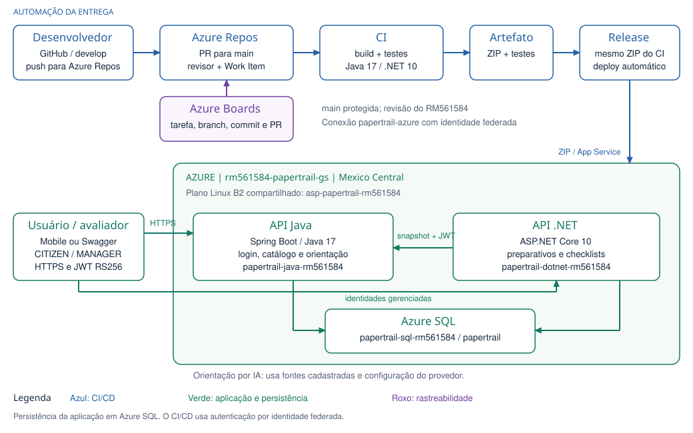

# PaperTrail Java

O PaperTrail é um projeto CitizenTech da Global Solution da FIAP voltado à preparação para atendimentos em serviços públicos. A aplicação reúne requisitos e orientações sobre os serviços para que o cidadão organize o que precisa antes do atendimento.

Este repositório contém a API Java, responsável pela autenticação, pelo catálogo e pelas respostas baseadas nas fontes cadastradas. A API .NET consulta os requisitos e a versão de cada serviço para criar os preparativos. O token emitido no login permite acessar as duas APIs.

## Vídeos

- Pitch do projeto: <https://www.youtube.com/watch?v=ryRj5UnI-0o>
- Demonstração de DevOps: <https://www.youtube.com/watch?v=CRfGrDgIHB8>

## Aplicação publicada

- Swagger Java: <https://papertrail-java-rm561584.azurewebsites.net/swagger-ui/index.html>
- Swagger .NET: <https://papertrail-dotnet-rm561584.azurewebsites.net/swagger>

Para testar a aplicação publicada, crie uma conta em `POST /auth/register` e faça o login em `POST /auth/login`. Os exemplos de requisição estão na seção de autenticação.

As duas APIs publicadas usam o mesmo banco Azure SQL, com autenticação por identidade gerenciada. Para testar pelos links acima, basta criar uma conta na aplicação; não é necessário configurar um banco local. Os dados da carga inicial são fictícios.

## Execução local

O projeto usa Java 17. Execute os comandos abaixo no Git Bash, dentro do repositório.

### Banco de dados

O caminho principal usa SQL Server. Prepare um banco próprio e execute [scripts/script-bd.sql](scripts/script-bd.sql) uma vez, em um banco vazio. Se as duas APIs forem executadas localmente, configure ambas para esse mesmo banco.

O Azure SQL publicado usa identidade gerenciada do App Service, que não está disponível na máquina local. O acesso direto a esse banco exige uma identidade autorizada e a liberação da conexão. As credenciais do banco não são necessárias para usar as APIs publicadas.

O Oracle da FIAP fica como alternativa para quem tem uma conta válida e não dispõe de um SQL Server próprio. A configuração dessa alternativa está no final das instruções de inicialização.

### Chaves de autenticação

Gere o par RSA em `.local/`, pasta que fica fora do Git:

```bash
mkdir -p .local
openssl genpkey -algorithm RSA -pkeyopt rsa_keygen_bits:2048 -out .local/private.pem
openssl pkey -in .local/private.pem -pubout -out .local/public.pem
export JWT_PRIVATE_KEY="file:$(pwd -W)/.local/private.pem"
export JWT_PUBLIC_KEY="file:$(pwd -W)/.local/public.pem"
```

Mantenha o mesmo par de chaves entre execuções. A API .NET precisa da chave pública correspondente para validar os tokens emitidos pelo Java.

### Inicialização

O perfil `azure` também pode ser usado na execução local com SQL Server. Para um banco próprio com usuário e senha, a URL JDBC segue este formato:

```text
jdbc:sqlserver://seu_servidor:1433;databaseName=papertrail;encrypt=true;trustServerCertificate=false
```

Na mesma sessão das chaves RSA, selecione o perfil e informe a conexão:

```bash
export SPRING_PROFILES_ACTIVE=azure
read -r -p "SQL Server JDBC URL: " DATABASE_URL
read -r -p "SQL Server user: " SPRING_DATASOURCE_USERNAME
read -r -s -p "SQL Server password: " SPRING_DATASOURCE_PASSWORD
export DATABASE_URL SPRING_DATASOURCE_USERNAME SPRING_DATASOURCE_PASSWORD
./gradlew bootRun
```

O Swagger local fica em <http://localhost:8080/swagger-ui/index.html>.

<details>
<summary>Alternativa: executar com Oracle da FIAP</summary>

Execute [docs/database/papertrail.sql](docs/database/papertrail.sql) no SQL Developer com F5, uma vez por schema. Se o .NET já usa as tabelas dessa conta, mantenha a instalação existente. Os scripts Oracle também fazem parte da entrega da disciplina de Database.

Com as chaves RSA já configuradas, use os comandos abaixo no lugar da inicialização com SQL Server:

```bash
unset SPRING_DATASOURCE_USERNAME SPRING_DATASOURCE_PASSWORD
export SPRING_PROFILES_ACTIVE=default
export DATABASE_URL="jdbc:oracle:thin:@//oracle.fiap.com.br:1521/ORCL"
read -r -p "Oracle user: " DATABASE_USERNAME
read -r -s -p "Oracle password: " DATABASE_PASSWORD
export DATABASE_USERNAME DATABASE_PASSWORD
./gradlew bootRun
```

A configuração sem perfil específico mantém o Oracle como padrão. Os comandos do caminho principal selecionam SQL Server explicitamente.

</details>

## Autenticação

O cadastro público cria uma conta com o papel `CITIZEN`. Envie nome, e-mail e senha para `POST /auth/register`:

```json
{"name":"Cidadão de teste","email":"citizen@example.invalid","password":"example-password"}
```

Depois do cadastro, envie as credenciais para `POST /auth/login`:

```json
{"email":"citizen@example.invalid","password":"example-password"}
```

O login retorna `{"token":"..."}`. Use esse valor no cabeçalho `Authorization: Bearer <token>` das chamadas protegidas. Para consultar a conta autenticada, use `GET /auth/me`.

Contas com o papel `MANAGER` podem alterar o catálogo. Esse papel depende de uma alteração administrativa no banco e não pode ser escolhido no cadastro público.

A senha deve ter de 8 a 72 caracteres e respeitar o limite de 72 bytes em UTF-8. Os tokens usam RS256 e expiram após 30 minutos. Nas chamadas autenticadas, o Java também verifica se o usuário e seu papel continuam válidos no banco.

## Uso da API

Cidadãos e gestores podem consultar o catálogo. As operações de criação, edição e exclusão exigem o papel `MANAGER`.

| Método | Rota | Uso |
| --- | --- | --- |
| GET | `/categories` | Lista categorias |
| GET | `/categories/{id}` | Consulta uma categoria |
| POST | `/categories` | Cria uma categoria |
| PUT | `/categories/{id}` | Atualiza uma categoria |
| DELETE | `/categories/{id}` | Exclui uma categoria sem serviços |
| GET | `/services` | Lista serviços |
| GET | `/services/{id}` | Consulta um serviço |
| POST | `/services` | Cria um serviço |
| PUT | `/services/{id}` | Atualiza um serviço e sua versão |
| DELETE | `/services/{id}` | Exclui um serviço sem vínculos |
| GET | `/services/{serviceId}/requirements` | Lista os requisitos do serviço |
| GET | `/services/{serviceId}/requirements/{id}` | Consulta um requisito |
| POST | `/services/{serviceId}/requirements` | Cria um requisito |
| PUT | `/services/{serviceId}/requirements/{id}` | Atualiza um requisito |
| DELETE | `/services/{serviceId}/requirements/{id}` | Exclui um requisito |
| GET | `/services/{id}/requirements-snapshot` | Retorna versão e requisitos para o .NET |
| POST | `/services/{id}/guidance` | Responde uma pergunta com base nas fontes |
| GET | `/services/{id}/guidance-chunks` | Lista os trechos cadastrados pelo gestor |
| POST | `/services/{id}/guidance-chunks` | Cadastra um trecho e sua fonte |
| PUT | `/services/{id}/guidance-chunks/{chunkId}` | Atualiza um trecho |
| DELETE | `/services/{id}/guidance-chunks/{chunkId}` | Exclui um trecho |

### Catálogo

Para cadastrar uma categoria, informe `name`. No cadastro de um serviço, informe `categoryId`, `title`, `description` e `cityName`. As listagens aceitam `page`, `size` e `sort`; a primeira página é 0, com até 100 registros por página.

Um requisito recebe `title`, `required` e `sourceUrl`. A criação, edição ou exclusão de um requisito incrementa a versão do serviço, que acompanha a cópia dos requisitos enviada ao .NET.

### Orientação com fontes

Envie uma pergunta no formato `{"question":"Quais documentos preciso?"}` para a rota de orientação do serviço. O RAG consulta as fontes da versão atual para buscar os trechos que serão usados na resposta. Se não encontrar trechos relevantes, retorna `insufficientEvidence=true` sem chamar o modelo.

O provedor usa a variável `OPENAI_API_KEY`. A rota retorna 404 quando o serviço não existe e 503 se houver falha na chamada ao modelo. A recuperação usa BM25 sobre os textos cadastrados, com normalização de acentos e termos comuns; não usa embeddings nem treinamento do modelo.

A carga de referência está em [official-services.json](src/main/resources/guidance/official-services.json). Ela contém fontes oficiais para primeira CIN de adulto nascido no Brasil em SP, Cadastro Único e renovação da CNH A/B sem EAR em SP. Cada serviço informa seu recorte e a origem das orientações. Os exemplos fictícios da carga de Database continuam separados desses serviços.

Para carregar ou atualizar essas fontes, faça login com um gestor e use o token na variável abaixo. O script reaproveita serviços, requisitos e trechos existentes pelo nome, sem apagar dados:

```bash
read -r -s -p "Token MANAGER: " PAPERTRAIL_MANAGER_TOKEN
export PAPERTRAIL_MANAGER_TOKEN
powershell.exe -NoProfile -ExecutionPolicy Bypass -File scripts/load-guidance.ps1 \
  -BaseUrl https://papertrail-java-rm561584.azurewebsites.net
unset PAPERTRAIL_MANAGER_TOKEN
```

O script imprime os IDs e as versões para uso no Swagger e no Mobile. A revisão de uma exigência incrementa a versão do serviço; os trechos precisam acompanhar essa versão para continuar disponíveis na orientação.

### Eventos do catálogo

As alterações de serviços e requisitos geram eventos de versão após o commit. Com `CATALOG_EVENTS_ENABLED=true`, o Java publica no RabbitMQ usando `RABBITMQ_HOST`, `RABBITMQ_PORT`, `RABBITMQ_USERNAME`, `RABBITMQ_PASSWORD`, `RABBITMQ_VHOST` e `RABBITMQ_SSL`. A exchange é `papertrail.catalog`, a routing key é `catalog.service.updated` e a fila é `papertrail.dotnet.catalog-version`.

O .NET consome esses eventos para sinalizar preparativos desatualizados. A publicação exige confirmação do broker; a reconciliação reenvia as versões atuais periodicamente para recuperar falhas de envio. O conteúdo pessoal dos preparativos é preservado.

## Banco e publicação

O perfil `azure` configura a conexão com o SQL Server. O Flyway permanece desativado; na inicialização, a aplicação valida a estrutura das tabelas existentes.

O script [scripts/provision-azure.sh](scripts/provision-azure.sh) cria os recursos na Azure, e [scripts/script-bd.sql](scripts/script-bd.sql) instala o schema SQL Server em um banco vazio. Os scripts Oracle da disciplina de Database ficam em `docs/database`.

O pacote de publicação contém `app.jar` e `startup.sh`. As chaves RSA ficam nas configurações protegidas do App Service. Durante a inicialização, o script cria os arquivos PEM e inicia a aplicação.

## Testes

Para executar os testes sem chamadas reais ao provedor de IA:

```bash
env -u OPENAI_API_KEY ./gradlew test
```

Os testes usam H2 e chaves RSA temporárias. Os testes com IA real são habilitados quando `OPENAI_API_KEY` está definida.

A avaliação das fontes oficiais pode ser executada com `./gradlew test --tests '*OfficialSourcesLiveTest' --rerun-tasks`. Ela chama a OpenAI real, usa os textos versionados em memória e gera `build/reports/guidance-official-live.json` com os resultados e as latências. A validação HTTP com persistência e autenticação é feita separadamente.

## Uso de IA no desenvolvimento

Foram usadas ferramentas de IA para apoiar implementação, testes e documentação. O grupo revisa o código e os dados e responde pelas decisões e pelos resultados apresentados.

## CI e publicação

O arquivo [azure-pipeline.yml](azure-pipeline.yml) define as etapas de CI e Release. O merge por PR na `main` aciona o build, os testes e a geração do ZIP. A Release baixa esse mesmo artefato, publica no App Service e verifica a resposta da API. As chamadas reais de IA ficam desativadas no CI.

A conexão `papertrail-azure` usa identidade federada. As chaves RSA e a configuração do banco permanecem no App Service. O script de provisionamento também cria a identidade dos pipelines; `PIPELINE_FEDERATION_ISSUER` e `PIPELINE_FEDERATION_SUBJECT` recebem os valores fornecidos pela conexão do Azure DevOps para configurar a federação.

Os pipelines ficam em <https://dev.azure.com/RM561584/PaperTrail-GS-2026-2/_build>.

## Arquitetura e entrega



A identificação do grupo, os acessos e as evidências de publicação estão em [docs/devops/PaperTrail_rm561584.pdf](docs/devops/PaperTrail_rm561584.pdf).
